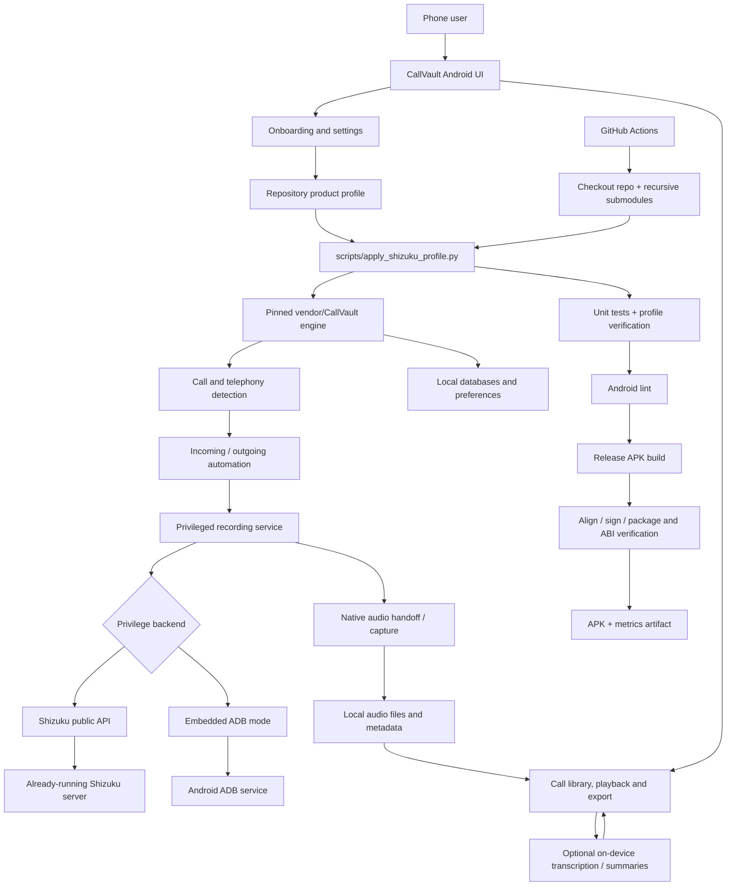

# Call Recorder — AI Project Knowledge Graph

> Share this file with another AI assistant as the project map and handoff context.
> Generated from the repository at the time of writing; verify the pinned upstream source before making code changes.

## Project identity

- Repository: [Wasifazhar00/Call-recorder](https://github.com/Wasifazhar00/Call-recorder)
- Branch: `main`
- Product: local-first Android cellular call recorder, based on the CallVault engine.
- Target device for validation: OnePlus 11R (CPH2487), Android 16 / OxygenOS 16.0.5, Google Phone, non-rooted.
- Android application ID: `com.baba.callvault`
- Minimum SDK: 30; compile/target SDK: 36; release ABI: `arm64-v8a`.
- Engine submodule: `vendor/CallVault` → [madkongo/CallVault](https://github.com/madkongo/CallVault), pinned at `00a77594085d61aee2c8513c649911704fd970c6`.
- Product-profile script: `scripts/apply_shizuku_profile.py`; verifier: `scripts/verify_shizuku_profile.py`.

## High-level architecture



## Component map

| Component | Location | Responsibility |
|---|---|---|
| Product configuration | `scripts/apply_shizuku_profile.py` | Applies revision-checked product defaults to the pinned engine; designed to be repeatable |
| Profile verification | `scripts/verify_shizuku_profile.py` | Checks required wiring and product-profile invariants |
| Android app and engine | `vendor/CallVault` | Main Kotlin/Android application, capture lifecycle, services, storage, playback and UI |
| Privilege integration | `vendor/CallVault/app/src/main/java/com/baba/callvault/integrations/adb/` and Shizuku backend sources | Uses either Shizuku's public API or built-in ADB pathway |
| Call data | `vendor/CallVault/app/src/main/java/com/baba/callvault/data/calls/` | Call history and phone-call metadata |
| Recording data | `vendor/CallVault/app/src/main/java/com/baba/callvault/data/recordings/` | Recording catalog, import, metadata and persistence |
| Transcript data | `vendor/CallVault/app/src/main/java/com/baba/callvault/data/transcripts/` | Transcript, speaker-turn, tag, note and export features |
| Native components | CallVault native build and bundled upstream dependencies | Audio handoff and on-device speech/summary runtimes |
| CI pipeline | `.github/workflows/android.yml` | Checkout, profile application, tests, lint, release build, APK verification and artifact upload |
| Product documentation | `README.md`, `docs/*.md` | Target constraints, setup, acceptance tests, licensing and product decisions |

## Runtime relationships

1. Android telephony/call-state signals are consumed by CallVault's call-detection and automation paths.
2. Incoming/outgoing automation decides whether capture should start according to user settings and the active profile.
3. The capture service obtains the required privileged execution through the selected backend.
4. The selected backend is either the Shizuku public API (using an already-running Shizuku-compatible server) or CallVault's built-in ADB flow. The repository profile defaults to Shizuku.
5. Audio and call metadata are finalized into local storage and surfaced in the recording library.
6. Transcription, summaries, speaker labels, search and export are downstream features; model downloads are optional.
7. GitHub Actions checks the profile and tests/lints/builds the pinned engine into an arm64 test APK.

## Privilege backend notes

- Shizuku is an external manager/server, not a library bundled into this APK.
- The app uses Shizuku's public API. A compatible manager fork may work if it preserves that API/permission contract; validate installation, permission grant, server startup and reboot recovery on the actual device.
- Shizuku-Next is an optional external fork to evaluate, not a proven OnePlus 11R dependency. Do not hardcode a fork-specific package name or claim its startup/watchdog behaviour is verified.
- In Shizuku mode, this app does not need its own Wireless Debugging pairing once Shizuku is running and permission has been granted. A non-rooted phone still needs a supported way to start Shizuku, and reboot recovery must be tested.
- The built-in ADB backend is a separate mode with its own setup/debugging requirements.

## Build and verification path

```text
GitHub Actions
  └─ checkout main + recursive vendor submodules
      └─ JDK 17 + Android SDK 36 + NDK 27.2.12479018
          └─ apply_shizuku_profile.py (twice; idempotence check)
              └─ verify_shizuku_profile.py
                  └─ :app:testDebugUnitTest
                      └─ :app:lintRelease
                          └─ :app:assembleRelease
                              └─ zipalign + apksigner + package/ABI checks
                                  └─ APK + metrics artifact
```

The CI test APK uses a disposable test/debug signing key, not a permanent production key. Successful CI does not prove real call audio capture on the target handset.

## Target-device acceptance criteria

The exact target is OnePlus 11R (CPH2487), Android 16 / OxygenOS 16.0.5, Google Phone, non-rooted. No physical test result is implied by this graph.

Before calling the app compatible, test on that handset:
- incoming and outgoing cellular calls;
- intelligibility of both participants in each saved recording;
- file finalization, playback and call metadata;
- Shizuku mode with Wireless debugging disabled after Shizuku is already running;
- reboot and Shizuku restart/recovery;
- screen-off, battery saver, idle standby and process death;
- Bluetooth and wired audio routes;
- clear failure reporting (never report a silent/empty file as a successful recording).

Call capture depends on Android/OEM restrictions and privileged access. Never promise both-sided recording on this device without the physical acceptance tests. Keep recording state visible, comply with local consent law, and do not suppress announcements or conceal recording.

## Instructions for another AI

1. Treat this document as an architectural index, not proof that every feature works on every Android/OEM version.
2. Read the current `README.md`, `docs/CALL_RECORDING_INTEGRATION.md`, `docs/SHIZUKU_FIRST_PROFILE.md`, and `.github/workflows/android.yml` before editing.
3. Inspect the pinned `vendor/CallVault` submodule at the exact gitlink commit. Do not assume the submodule tracks its upstream default branch.
4. Preserve upstream GPL-3.0-or-later licensing, Section 7 terms, notices and modification notices.
5. Keep profile patches revision-checked and idempotent; update the verifier and tests when profile behaviour changes.
6. Run unit tests, lint and release build after changes. Inspect the complete workflow result and verify the APK package, ABI, alignment and signature.
7. Separate verified facts, source-derived expectations and device-only unknowns in every report.
8. Do not replace the capture engine with ordinary microphone recording; that is not a reliable way to capture both cellular-call directions on modern Android.

## Sources of truth

- Product repository: https://github.com/Wasifazhar00/Call-recorder
- Pinned engine: https://github.com/madkongo/CallVault/tree/00a77594085d61aee2c8513c649911704fd970c6
- Product integration notes: [CALL_RECORDING_INTEGRATION.md](CALL_RECORDING_INTEGRATION.md)
- Shizuku profile notes: [SHIZUKU_FIRST_PROFILE.md](SHIZUKU_FIRST_PROFILE.md)
- Build workflow: [android.yml](../.github/workflows/android.yml)
